  

# ⚖️ Awesome Legal Clause Library & Standard Clauses

  
  
  

> 📜 A curated directory of top **Legal Clause Libraries**, **Standard Contract Clauses**, **AI Negotiation Playbooks**, and **Open-Source Contract Lifecycle Management (CLM)** tools for legal operations, procurement, and commercial contracting teams.
>
> 🌟 Star this repo if you find it useful! 🌟

---

## 📋 Table of Contents

- [🌐 Sector Overview & Market Dynamics](#-sector-overview--market-dynamics)
- [🏢 Enterprise SaaS & Hosted Clause Library Platforms](#-enterprise-saas--hosted-clause-library-platforms)
- [🔓 Open-Source Software & Clause Frameworks](#-open-source-software--clause-frameworks)
- [📊 Feature Comparison at a Glance](#-feature-comparison-at-a-glance)
- [🎯 Key Selection Criteria for Legal Clause Libraries](#-key-selection-criteria-for-legal-clause-libraries)
- [💖 Support](#-support)
- [🤝 Contributing](#-contributing)
- [📄 License](#-license)
- [⭐ Star History](#-star-history)

---

## 🌐 Sector Overview & Market Dynamics

The global Contract Lifecycle Management (CLM) and legal clause management market was valued at approximately **$2.3 billion in 2024** and is projected to expand to **$5.9 billion by 2032**, registering a compound annual growth rate (CAGR) of **12.5%**. The sector has experienced a profound structural evolution driven by generative AI, large language model (LLM) redlining, and automated playbook compliance.

The market displays a **moderately concentrated, bifurcated structure**:
- **Dominant Enterprise Giants & High-Valuation Challengers**: A tier of hyperscale platforms (DocuSign, Icertis, Ironclad, Conga, and Agiloft) commands the lion's share of Fortune 500 enterprise legal spend, offering end-to-end CLM suites with native ERP and CRM integration.
- **Specialized AI Drafting Engines & Emerging Open-Source Ecosystem**: Fast-growing specialized players (e.g., Robin AI) and emerging open-source platforms (such as OpenContracts, OpenCLM, Cicero, and draftLegal) are democratizing clause-level extraction, citation tracking, and git-style contract composition without enterprise software vendor lock-in.

---

## 🏢 Enterprise SaaS & Hosted Clause Library Platforms

The following table benchmarks leading commercial cloud legal clause libraries and CLM platforms. Sorted in **descending order by company valuation / revenue scale**.

| Platform | Valuation / Revenue | Pricing (Starting Tier) | Free Tier / Free Trial Limits | Key Clause Capabilities | Best For |
|:---|:---|:---|:---|:---|:---|
| **[DocuSign CLM](https://www.docusign.com/products/clm)** | **$14.5B+ MCap** ($3.2B+ ARR) | Custom quote (Self-serve IAM tiers start at ~$45–$80/user/mo billed annually) | ❌ No free tier or self-serve trial for CLM (eSignature has 30-day trial; CLM requires sales demo) | Centralized pre-approved clause library, legal-defined fallback clauses, Salesforce document generation integration | Salesforce-centric enterprises integrating clause management with CPQ and agreement workflows |
| **[Icertis](https://www.icertis.com/)** | **$5.0B Valuation** (~$350M ARR) | Custom enterprise quote (Typically ~$88,000+/year minimum commitment) | ❌ No free tier or public free trial (Guided enterprise POC upon request) | AI-Generated Playbooks, Redline Agent for instant fallback suggestions, Risk Review Agent with clause-level intelligence | Fortune 500 enterprises requiring mission-critical clause governance across massive contract portfolios |
| **[Ironclad](https://ironcladapp.com/)** | **$3.2B Valuation** (~$200M+ ARR) | Custom annual quote (Typically ~$50,000+/year base; entry configurations cite ~$500/mo) | ❌ No free tier or public self-serve trial (Custom guided sales evaluation only) | Clause repository bank, AI Contract Review Agent, precedent-based redlining, automated playbook compliance | In-house legal ops teams seeking modern UX, collaborative negotiation, and automated approval workflows |
| **[Conga](https://conga.com/)** | **$715M+ Valuation** (~$200M–$380M ARR) | Custom quote (Modular generation components starting ~$35/user/mo; full CLM typically ~$17,000+/year) | ❌ No standard free tier for CLM (7 to 30-day evaluations available for specific add-ons via partner marketplaces) | Enterprise clause library, automated clause insertion into dynamic templates, automated approval escalation | High-volume contract and quote document generation tightly paired with Salesforce and enterprise CPQ |
| **[Agiloft](https://www.agiloft.com/)** | **KKR Majority Investment** (~$50M–$70M ARR) | Custom quote-based (Entry packages start ~$6,000/year or ~$65–$150/user/mo; standalone Astra AI starts at $120/mo) | ⚠️ Free Tier available exclusively on **Astra AI** ($0/month with limited monthly credits); core CLM requires sales demo | AI-assisted contract review, automated risk detection, instant fallback clause recommendations, obligation tracking | Organizations requiring flexible, no-code configurable workflows and deep clause-level risk detection |
| **[CobbleStone](https://www.cobblestonesoftware.com/)** | **~$25M–$30M ARR** (Privately Held) | Custom enterprise quote (Entry SaaS tiers historically start around $59/user/month) | ✅ **30-Day Free Trial** available with full sandbox access to standard features | Pre-approved clause bank, clause versioning, template merging, audit trails, and automated approval chains | Mid-market enterprises, healthcare institutions, and public sector organizations seeking proven governance |
| **[Robin AI](https://www.robinai.com/)** | **~$100M–$250M Est. Valuation** (~$10M ARR) | Custom quote for Pro & Enterprise (Freemium tier available) | ✅ **Free Tier** ($0/month with up to 10 free AI messages per day & basic document review) | Conversational contract assistant, clickable citations directly referencing source clauses, deviation comparison | Legal and procurement teams wanting rapid AI-driven contract verification with clause-level traceability |

---

## 🔓 Open-Source Software & Clause Frameworks

Community-driven, open-source libraries, CLM engines, and clause extraction frameworks. Sorted in **descending order by GitHub star count**.

| Project | Stars (Community) | Stack / Tech | License | Core Clause Architecture |
|:---|:---:|:---|:---|:---|
| **[OpenContracts](https://github.com/Open-Source-Legal/OpenContracts)** |  | Python / Django / React | Apache-2.0 | Open-source document intelligence and contract analysis platform. Extracts clauses, analyzes terms, and annotates multi-page contracts using layout-aware AI models. |
| **[awesome-legal](https://github.com/ankane/awesome-legal)** |  | Markdown / Curated | CC0-1.0 | Curated directory of open legal documents, standard startup clauses, advisor agreements, NDAs, and convertible instrument templates. |
| **[accordproject/template-archive](https://github.com/accordproject/template-archive)** |  | TypeScript / Cicero | Apache-2.0 | Canonical Accord Project repository of smart legal clauses and computable contract templates. Connects natural language legal text directly to executable data models. |
| **[accordproject/concerto](https://github.com/accordproject/concerto)** |  | TypeScript / Node.js | Apache-2.0 | Schema modeling language and validator for smart legal contracts. Formally models clause parameters, parties, financial obligations, and state machines. |
| **[alexch/clauses](https://github.com/alexch/clauses)** |  | Ruby / Markdown | MIT | Modular, open-source legal clause library for independent software consultants, engineers, and agencies (IP assignment, warranty disclaimers, liability caps). |
| **[cicero-template-library](https://github.com/accordproject/cicero-template-library)** |  | JavaScript / TemplateMark | Apache-2.0 | Community library of pre-packaged, parameterized clause templates for Cicero and Accord Project smart agreements. |
| **[draftLegal](https://github.com/AniketTati/draft-legal)** |  | TypeScript / Python / Docker | AGPL-3.0 | Self-hosted, AI-native contract lifecycle management suite. Features clause-level extraction with page-level PDF citations, 3-tier counter-proposal redlining, and automated playbooks. |
| **[reference.legal](https://github.com/dot-legal/reference)** |  | Markdown / Web | CC0-1.0 | Hyperlink-addressable standard clause repository designed to write shorter contracts by linking directly to standardized canonical boilerplate provisions. |
| **[template-vault](https://pypi.org/project/template-vault/)** |  | Python / Git CLI | Open Source | Git-native contract template composition tool. Enables clause swapping from parent templates with provenance preservation in `clause_overrides` and automatic version upgrading. |
| **[OpenCLM](https://openclm.ai/)** |  | TypeScript / PostgreSQL / Docker | AGPL-3.0 | Self-hostable, full CLM application featuring version-controlled clause and template libraries, multi-role approval workflows, collaborative redlines, and e-signatures. |
| **[Codify Core](https://github.com/codifycli/codify)** |  | Python / Akoma Ntoso XML | Apache-2.0 | Ingestion engine converting legal agreements and legislation into machine-readable Akoma Ntoso 3.0 XML with anchored clause indexing, REST API, and MCP tool endpoints. |
| **[contract-vault](https://pypi.org/project/contract-vault/)** |  | Python / Git CLI | Open Source | Post-signature contract repository pairing with `template-vault`. Tracks executed clause obligations, party responsibilities, and expiration timelines backed by Git audit trails. |

---

## 📊 Feature Comparison at a Glance

| Platform / Tool | Type | Clause Library | Fallback Positions | AI Redlining | Self-Hosted | Primary Ideal Use Case |
|:---|:---|:---:|:---:|:---:|:---:|:---|
| **DocuSign CLM** | Commercial SaaS | ✅ Centralized | ✅ Legal-defined | ✅ Optional | ❌ Cloud | High-volume enterprise generation & Salesforce alignment |
| **Icertis** | Commercial SaaS | ✅ Hierarchical | ✅ AI-generated playbooks | ✅ Redline Agent | ❌ Cloud | Enterprise-wide contracting and multi-system integration |
| **Ironclad** | Commercial SaaS | ✅ Dynamic bank | ✅ Precedent-based | ✅ Review Agent | ❌ Cloud | Modern legal operations and real-time negotiation |
| **Conga** | Commercial SaaS | ✅ Cataloged | ✅ Conditional rules | ✅ Optional | ❌ Cloud | Heavy quote-to-contract and CPQ document automation |
| **Agiloft** | Commercial SaaS | ✅ Metadata-tagged | ✅ Auto-suggestions | ✅ Astra AI | ✅ Hybrid | Configurable workflow governance and risk analysis |
| **CobbleStone** | Commercial SaaS | ✅ Versioned bank | ✅ Defined fallbacks | ✅ VISDOM AI | ✅ Cloud/On-prem | Mid-market, healthcare, and public sector compliance |
| **Robin AI** | Commercial SaaS | ✅ Analysis index | ✅ Comparative | ✅ Direct citations | ❌ Cloud | Fast conversational redlining with strict verification |
| **OpenContracts** | Open Source | ✅ Segmented | ⚠️ Custom pipeline | ✅ Layout-aware | ✅ Self-hosted | Large-scale AI document extraction & clause annotation |
| **Accord Project** | Open Source | ✅ Computable | ✅ Logical branches | ⚠️ Via MCP / LLM | ✅ Self-hosted | Smart, computable agreements & programmable clauses |
| **draftLegal** | Open Source | ✅ Extracted bank | ✅ 3-tier proposals | ✅ Agentic tools | ✅ Self-hosted | Complete self-hosted AI-driven contract negotiation |
| **template-vault** | Open Source | ✅ Git-backed | ✅ `clause_overrides` | ⚠️ Metadata only | ✅ Local/Git | Developer-centric clause versioning & provenance |
| **OpenCLM** | Open Source | ✅ Template bank | ✅ Standard edits | ⚠️ Roadmap | ✅ Self-hosted | Free self-hosted CLM infrastructure for SMBs |

---

## 🎯 Key Selection Criteria for Legal Clause Libraries

When evaluating clause management tools for your enterprise or development stack, consider:

1. **Hierarchy & Fallback Flexibility**: Does the platform support primary positions, fallback options (Tier 1 / Tier 2), and strict non-negotiable walk-away clauses?
2. **AI Verification & Hallucination Prevention**: Does the AI quote exact clause text and provide line/page citations, or does it generate ungrounded summaries?
3. **Drafting Environment Integration**: Can drafters access approved clause blocks directly inside Microsoft Word, Google Docs, or your web editor of choice?
4. **Metadata & Governance**: Are clauses versioned, attributed to a legal owner, and subject to automatic expiration or periodic legal review?
5. **Data Sovereignty & Security**: Can you self-host the repository or run local models (crucial for sensitive M&A agreements, NDAs, and confidential customer contracts)?

---

## 💖 Support

Thank you for visiting and utilizing this curated directory! If you find this resource helpful for your legal engineering, procurement, or contract automation projects, please consider supporting it:

- ⭐ **Star this repository** to improve discoverability for fellow legal tech architects and developers.
- 🍴 **Fork and contribute** new open-source clause libraries, standards, or benchmarks.
- 📢 **Share** this collection with your legal ops, engineering, and contract management peers.
- ☕ **Sponsor**: If you would like to support the ongoing curation and maintenance of open-source knowledge bases, please check out the [GitHub Sponsors Dashboard](https://github.com/sponsors/ishandutta2007).

---

## 🤝 Contributing

Contributions are warmly welcomed! 🙌 If you know of an innovative open-source clause management tool, standard contracting framework, or legal dataset:

1. 🍴 **Fork this repository**
2. 🌿 **Create a feature branch** (`git checkout -b feature/add-new-clause-tool`)
3. ✍️ **Add the tool** with precise details (licensing, stack, GitHub star badge, and unique capabilities)
4. 💾 **Commit your changes** (`git commit -m 'Add new legal clause tool'`)
5. 🚀 **Push to the branch** (`git push origin feature/add-new-clause-tool`)
6. 📬 **Submit a Pull Request**

---

## 📄 License

This repository is distributed under the [CC0 1.0 Universal (Public Domain)](https://creativecommons.org/publicdomain/zero/1.0/) license. Individual products, software packages, and tools mentioned retain their respective copyrights and licensing terms.

---

## Star History

